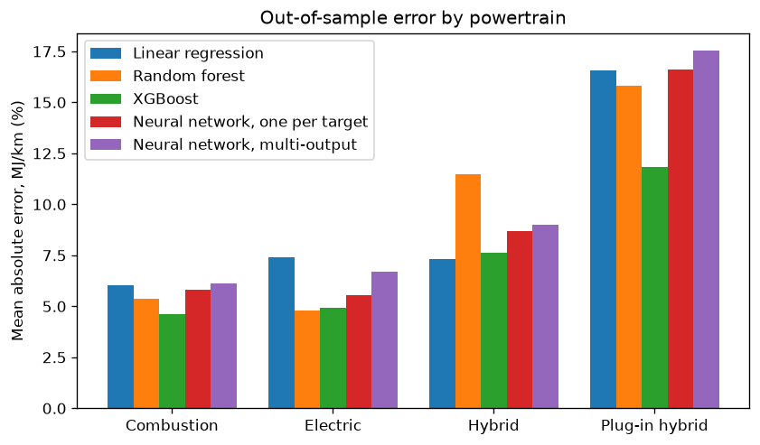
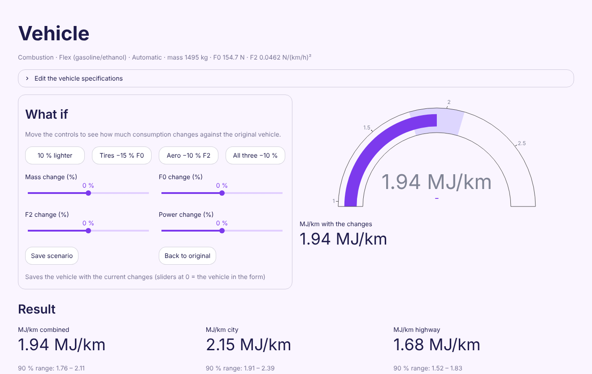
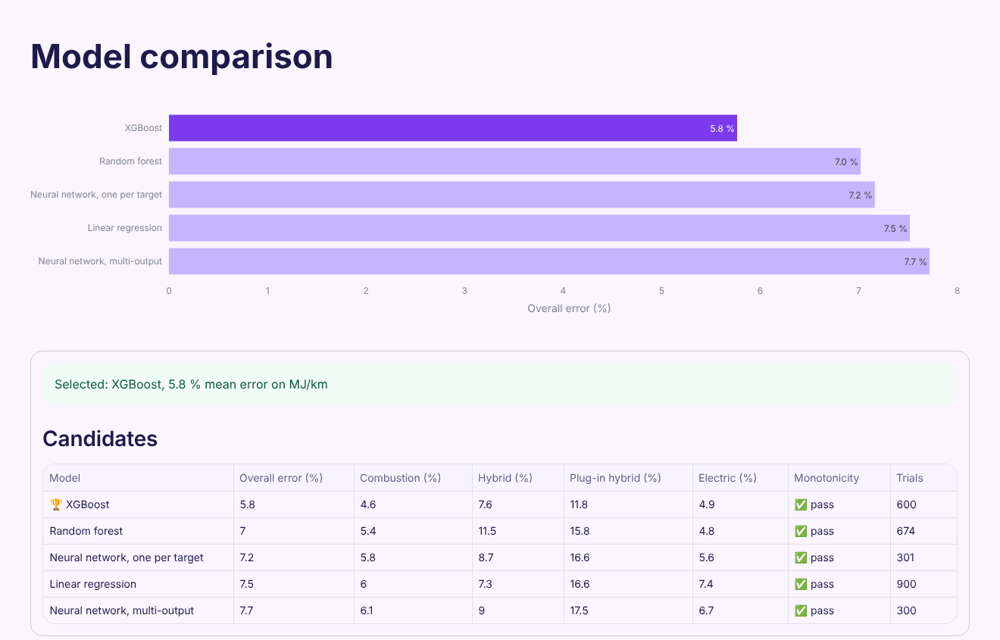

# Vehicle energy efficiency estimator

[](https://github.com/FelipeEckert/fuel-efficiency-deeplearning/actions/workflows/ci.yml)

Predicts the label energy consumption of a light vehicle (MJ/km and km/l, on the Brazilian PBEV test cycle) from its technical specifications: mass, road-load coefficients, power, powertrain, transmission and battery. It is trained on the 2026 data of Brazil's vehicle labeling program (PBEV, run by Inmetro) and served through a Streamlit app.

The project is also a controlled comparison between classic regression and deep learning on a small tabular dataset: five model families, the same grouped validation, the same hyperparameter budget and the same physical constraints.



## Results

All errors are the mean absolute percentage error on combined MJ/km, measured out of sample with nested cross-validation grouped by model family, so versions of the same car never appear in both training and validation.

| Model | Overall | Combustion | Electric | Hybrid | Plug-in |
|---|---|---|---|---|---|
| Linear regression (ridge) | 7.52 % | 6.04 % | 7.39 % | 7.31 % | 16.57 % |
| Random forest | 7.02 % | 5.36 % | 4.80 % | 11.47 % | 15.83 % |
| **XGBoost (selected)** | **5.77 %** | **4.63 %** | **4.92 %** | **7.61 %** | **11.84 %** |
| Neural network, one per target | 7.16 % | 5.81 % | 5.55 % | 8.68 % | 16.59 % |
| Neural network, multi-output | 7.72 % | 6.12 % | 6.71 % | 9.00 % | 17.53 % |

- XGBoost wins with 5.77 % overall. Follow-up experiments with CatBoost (5.72 %) and LightGBM (5.80 %) land within seed noise of it, which suggests about 5.7 % is the limit of this data with these inputs.
- The neural networks do not beat the tree ensembles here. With 510 homologations, the data is too small for them to pull ahead.
- Plug-in hybrids are the hardest group, with only about 50 homologations in the data.

Full training report: [`relatorios/relatorio.md`](relatorios/relatorio.md). Optimization experiments (samplers, search space, seeds, network variants, other boosting libraries): [`relatorios/experimentos/conclusoes.md`](relatorios/experimentos/conclusoes.md).

## How it works

1. **Cleaning** (`eficiencia.dados`). The source spreadsheet has 844 vehicle versions with inconsistent units and formats: power in more than 200 notations, F2 in the wrong unit for some rows, battery capacity missing or wrong. The cleaner standardizes everything and collapses identical versions into 510 unique homologations, one row per test. Every rule is documented in [`data/README.md`](data/README.md).
2. **Grouped nested validation** (`eficiencia.validacao`). Hyperparameters are tuned with Optuna in an inner loop, and the error is measured in an outer loop, both split by model family. Studies are stored in SQLite and resume where they stopped, so long searches can run overnight.
3. **Physical constraints** (`eficiencia.monotonia`). More mass, inertia, F0 or F2 must never predict lower consumption. Every model is built with monotonic constraints, and a candidate is only eligible if a check on the trained model confirms it.
4. **Uncertainty** (`eficiencia.incerteza`). Each prediction comes with a range from conformal quantiles of the out-of-fold relative errors, per target.
5. **Coverage warnings** (`eficiencia.faixa`). The app flags inputs outside the ranges observed in the training data for that powertrain.
6. **Explanations** (`eficiencia.explicar`). For the XGBoost model, the app breaks a prediction into the contribution of each input (TreeSHAP values from `pred_contribs`) and can draw the path of the vehicle through a tree.

## The app



| Page | What it does |
|---|---|
| Vehicle | Estimate one vehicle, see the uncertainty range and the explanation, and compare "what if" scenarios (for example, 80 kg lighter). |
| Portfolio | Estimate several vehicles at once and compute the sales-weighted average consumption. Tables can be edited in the app or uploaded and downloaded as files. |
| Comparison | Compare the candidates from the latest training run: overall error, error by powertrain, monotonicity check and number of trials. |



## Getting started

Requires Python 3.14 and [uv](https://docs.astral.sh/uv/).

```bash
uv sync
uv run streamlit run app/Inicio.py
```

The trained XGBoost model is versioned in `modelos/vencedor/`, so the app works right after cloning.

### Data

The PBEV source spreadsheets are not part of this repository. To rebuild the clean table and retrain, place them in `data/raw/` (the expected file names and every cleaning rule are in [`data/README.md`](data/README.md)) and run:

```bash
uv run eficiencia-limpar      # writes data/processed/pbev_2026_limpo.csv
uv run eficiencia-treinar     # trains every candidate, picks the winner, writes modelos/ and relatorios/
```

### Training options

```bash
uv run eficiencia-treinar                    # 50 Optuna trials per study
uv run eficiencia-treinar --tentativas 200 --candidatos linear,xgboost   # only the listed candidates
uv run eficiencia-treinar --rapido           # fast mode for development and CI: writes to modelos/rapido/
uv run eficiencia-progresso --tentativas 100 # trials done, best error and status per candidate
uv run optuna-dashboard sqlite:///optuna/estudos.db   # study charts at http://localhost:8080
```

`--tentativas N` is the total per study: an interrupted run only completes what is missing, and a study that already has N trials does not run again. To search further, raise N.

Long runs work best in a separate git worktree, so app development does not touch the model being trained:

```bash
git worktree add ../fuel_treino -b treino-noturno origin/main
cd ../fuel_treino && uv sync && uv run eficiencia-treinar --tentativas 50
```

To point the app in the main folder at that model, set `EFICIENCIA_MODELO` and `EFICIENCIA_RELATORIOS` to the worktree's `modelos/vencedor` and `relatorios` folders before starting Streamlit.

## Tests and CI

```bash
uv run pytest -q
uv run ruff check . && uv run ruff format --check .
```

170 tests cover the cleaning rules, the physics helpers, every model family, the monotonicity and uncertainty logic, prediction, explanations and the app pages (with Streamlit's `AppTest`). When the source data is not available, as in CI, the suite generates a synthetic table with the same schema ([`tests/dados_sinteticos.py`](tests/dados_sinteticos.py)), so everything except the spreadsheet-cleaning checks and a few golden-value checks on the real data runs on every push and pull request.

## Project layout

```
app/                  Streamlit app: home, vehicle, portfolio and comparison pages
src/eficiencia/
  dados.py            spreadsheet cleaning
  esquema.py          model inputs, targets and categories
  validacao.py        grouped nested cross-validation with Optuna
  modelos/            linear, random forest, XGBoost, PyTorch networks (plus CatBoost and LightGBM for experiments)
  monotonia.py        physical monotonicity check
  incerteza.py        conformal uncertainty ranges
  faixa.py            coverage warnings
  explicar.py         per-input contributions
  prever.py           prediction API used by the app
  treino.py           training, model selection, artifacts and report
  experimentos.py     optimization experiments
modelos/vencedor/     versioned winning model
relatorios/           training report, figures and experiment results
tests/                pytest suite
```

## Language

The interface, reports and documentation are in English. Identifiers and code comments are in Portuguese, and the data keeps the original PBEV codes (for example, `Combustão` or `gasolina`), which the app shows with English names. Uploaded portfolio tables accept both the codes and the English names.

## Stack

Python 3.14, pandas, NumPy, scikit-learn, XGBoost, PyTorch, Optuna, CatBoost, LightGBM, Streamlit, Plotly, pytest, Ruff, uv and GitHub Actions.
