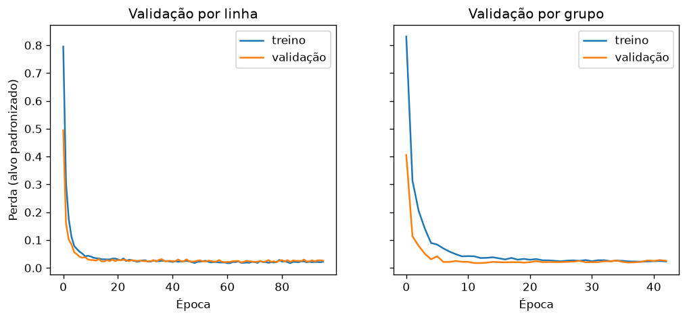

# Optimization experiments: conclusions

Seven hypotheses about where the remaining error comes from, tested after the first official training run. The raw results are in the `.json` files in this folder, and the code is in `src/eficiencia/experimentos.py` (`uv run eficiencia-experimento {samplers,cerca,sementes,redes,boosting}`).

**Summary:** no hypothesis cleared the two-standard-deviation bar.
- The published XGBoost (5.77 %) stays as the model.
- The search had already converged. The error that remains comes mostly from the limits of the data and from seed noise.
- CatBoost (5.72 %) and LightGBM (5.80 %) tie with XGBoost. Three different boosting libraries stop at the same point, close to 5.7 %, which looks like the limit of this data with these inputs.

Every error is the mean absolute percentage error on MJ/km, in the outer loop of the grouped nested cross-validation with 5 folds.

## Noise (the yardstick for every comparison)

| Source of noise | How it was measured | Std. dev. | 2 std. dev. |
|---|---|---|---|
| Model seed, XGBoost (H3) | published parameters fixed, 5 seeds | 0.11 pt | **0.22 pt** |
| Search seed, XGBoost | TPE with 3 sampler seeds, 50 trials | 0.035 pt | **0.07 pt** |
| Model seed, network per target | round 3 parameters fixed, 5 seeds, row-wise validation | 0.25 pt | **0.49 pt** |

The search deviation comes from only 3 seeds, so it is a fragile estimate.

## H3: part of the differences is seed noise

The published parameters stay fixed and only the XGBoost seed changes.

| Seed | MJ/km | Combustion | Electric | Hybrid | Plug-in |
|---|---|---|---|---|---|
| 0 | 5.62 | 4.60 | 4.79 | 7.06 | 11.54 |
| 1 | 5.72 | 4.73 | 4.70 | 7.51 | 11.33 |
| 2 | 5.66 | 4.51 | 4.83 | 7.35 | 11.96 |
| 3 | 5.50 | 4.40 | 4.77 | 7.39 | 11.01 |
| 4 | 5.80 | 4.66 | 4.79 | 7.62 | 12.25 |
| **mean** | **5.66 ± 0.11** | | | | |

**Verdict: confirmed.** The seed alone moves the error by 0.3 points (from 5.50 to 5.80 %). Differences below about 0.2 points between XGBoost configurations mean nothing.

The mean, 5.66 %, is below the official 5.77 %. That is because these parameters were chosen while looking at the whole dataset, while the official number picks them without seeing the test fold.

## H1: another sampler would beat TPE

Same nested CV as the XGBoost run, with 50 trials per study.

| Sampler | MJ/km | Combustion | Electric | Hybrid | Plug-in |
|---|---|---|---|---|---|
| TPE (seed 0) | 5.77 | 4.66 | 4.91 | 7.60 | 11.77 |
| TPE (seed 1) | 5.72 | 4.54 | 4.62 | 7.49 | 12.72 |
| TPE (seed 2) | 5.71 | 4.70 | 4.49 | 7.57 | 11.81 |
| **TPE, mean** | **5.73 ± 0.035** | | | | |
| QMC | 5.72 | 4.61 | 4.59 | 7.76 | 12.01 |
| GP | 5.74 | 4.62 | 4.50 | 7.89 | 12.23 |
| Random | 5.84 | 4.81 | 4.38 | 8.31 | 11.89 |
| CMA-ES | 5.88 | 4.82 | 5.09 | 7.46 | 11.70 |

**Verdict: rejected.** Against the TPE mean:
- **QMC and GP** tie, at −0.01 and +0.01 points;
- **Random and CMA-ES** are worse, at +0.11 and +0.15 points.

TPE stays as the default sampler, and a custom simulated annealing sampler is not worth building.

**Caveat:** H1 was only tested on XGBoost, whose search converged early (between trials 19 and 51). It says nothing about the networks, which were still improving at the end of their search.

## H2: the XGBoost search space is too narrow

Nested CV with `xgboost_amplo` (a wider search space), 100 trials per study, against the official XGBoost, which used the same 100 trials.

| Model | MJ/km | Combustion | Electric | Hybrid | Plug-in |
|---|---|---|---|---|---|
| Official XGBoost (current space) | 5.77 | 4.63 | 4.92 | 7.61 | 11.84 |
| XGBoost, wide space | 5.69 | 4.65 | 4.69 | 7.00 | 12.20 |

**Verdict: not confirmed, the gain is at the edge of the noise.** The wide space improves by 0.08 points.
- Against the search noise (0.07 points) it passes by 0.01 points, but that deviation comes from only 3 seeds.
- It does not pass the model seed bar (0.22 points).
- The best TPE seed with the current space already reaches 5.71 %, only 0.02 points above.

Hybrids improve by 0.6 points, but each powertrain has few cars, so the noise there is larger.

**Edges of the wide space** (the chosen parameter hit a limit):

| Fold | Trees | Depth | Parameter at the edge |
|---|---|---|---|
| 1 | 908 | 6 | `reg_lambda` = 0.0013 (minimum 0.001) |
| 2 | 2520 | 3 | `min_child_weight` = 0 (minimum) |
| 3 | 2639 | 7 | none |
| 4 | 1595 | 7 | none |
| 5 | 2015 | 8 | none |

The search used the new room: depth up to 8 and up to 2,639 trees, against the old limits of 6 and 1,500. Even so, the error barely moved. The folds picked very different combinations and reached similar errors, which points to a plateau: XGBoost is already close to what this data allows.

The cost is that the wide-space trees are larger, and trials became 2 to 3 times slower.

## H4: the networks stop at the wrong time because of "siblings" in validation

Network per target with the round 3 parameters. The early-stopping validation is done two ways: by row, as today, or by group, with no siblings of the training cars.

| Seed | By row | By group |
|---|---|---|
| 0 | 6.72 | 6.80 |
| 1 | 6.71 | 6.57 |
| 2 | 7.18 | 6.61 |
| 3 | 6.87 | 6.75 |
| 4 | 6.51 | 6.51 |
| **mean** | **6.80 ± 0.25** | **6.65 ± 0.12** |

By powertrain, averaged over the 5 seeds:

| Validation | Combustion | Electric | Hybrid | Plug-in |
|---|---|---|---|---|
| By row | 5.48 | 5.66 | 7.71 | 15.73 |
| By group | 5.32 | 5.61 | 7.77 | 15.17 |

**Verdict: not confirmed.** Group validation improves by 0.15 points, below the 0.49 bar. It also makes the network more stable: the deviation halves (0.12 against 0.25), but with only 5 seeds that is fragile too.

**Caveat:** the parameters were tuned with row-wise validation. A tie here does not rule out group validation: a search run with it from the start could end differently.

**Loss curves** (outer fold 1, target `mj_km_urbano`, seed 0):

In both modes the validation loss follows the training loss closely, with no sign of overfitting. With group validation, early stopping comes sooner, around epoch 42 against 95.

## H5: averaging several networks helps

| Setup | MJ/km | Combustion | Electric | Hybrid | Plug-in |
|---|---|---|---|---|---|
| 1 network (mean of 5 seeds, row-wise validation) | 6.80 ± 0.25 | 5.48 | 5.66 | 7.71 | 15.73 |
| average of 5 networks | 6.55 | 5.31 | 5.34 | 7.32 | 15.36 |

**Verdict: not confirmed.** Averaging 5 networks improves by 0.25 points, below the 0.49 bar. The trend goes the expected way, but it costs 5 times the training time.

## H6: the learning rate is holding the networks back

Fixed `lr` grid with seed 0. The round 3 `lr` is 0.00052, and with it the network reached 6.72 %.

| `lr` | MJ/km | Combustion | Electric | Hybrid | Plug-in |
|---|---|---|---|---|---|
| 0.0001 | 7.13 | 5.60 | 6.26 | 8.75 | 15.75 |
| 0.0003 | 6.80 | 5.36 | 5.68 | 8.01 | 16.06 |
| 0.001 | 6.68 | 5.35 | 5.83 | 7.38 | 15.32 |
| 0.003 | 6.82 | 5.67 | 5.72 | 8.13 | 14.24 |
| 0.01 | 8.04 | 6.01 | 6.72 | 8.97 | 21.39 |

**Verdict: rejected.** Between 0.0003 and 0.003 the error sits on a plateau (6.68 to 6.82 %), and the chosen `lr` is in the middle of it. Only the extremes get worse, mainly 0.01 (+1.3 points).

## H7: another boosting library beats XGBoost

CatBoost and LightGBM in the same nested CV as the official XGBoost, with 100 trials per study. Both use the same monotonic constraints as XGBoost: consumption can only rise with mass, F0, F2 and so on. They stay out of the official training (`EXPERIMENTAIS`).

| Model | MJ/km | Combustion | Electric | Hybrid | Plug-in |
|---|---|---|---|---|---|
| Official XGBoost | 5.77 | 4.63 | 4.92 | 7.61 | 11.84 |
| CatBoost | 5.72 | 4.54 | 5.13 | 7.23 | 11.87 |
| LightGBM | 5.80 | 4.57 | 4.84 | 7.07 | 13.38 |

**Verdict: not confirmed.** Against the official XGBoost, CatBoost improves by 0.05 points and LightGBM gets worse by 0.03. Both stay inside the search noise (0.07 points) and the model seed noise (0.22 points).
- CatBoost also sits next to the mean of the 3 TPE seeds with XGBoost (5.73 %) and the wide space (5.69 %).
- LightGBM errs more on plug-ins (13.4 % against 11.8 %), but there are only 50 plug-ins, so that is the noisiest number in the table.

**What the searches chose:**
- **CatBoost:** shallow trees, depth 4 to 6, with 490 to 1,900 iterations.
- **LightGBM:** 15 to 63 leaves, 950 to 1,930 trees and a low learning rate (0.012 to 0.034).

The folds reached very different combinations with similar errors, the same plateau seen in H2.

**Edges** (parameter within 5 % of the search limit):

| Fold | CatBoost | LightGBM |
|---|---|---|
| 1 | none | `reg_lambda` = 0.001 (minimum 0.001) |
| 2 | none | `num_leaves` = 63 (maximum 64) |
| 3 | none | `n_estimators` = 1,930 (maximum 2,000), `min_child_samples` = 2 (minimum) |
| 4 | `random_strength` = 9.7 (maximum 10) | none |
| 5 | `iterations` = 1,916 (maximum 2,000), `learning_rate` = 0.28 (maximum 0.3) | `min_child_samples` = 3 (minimum 2) |

- **CatBoost:** no parameter hits a limit in more than one fold.
- **LightGBM:** `min_child_samples` (the minimum number of cars per leaf) sits at the floor in two folds. It wants smaller leaves than the space allows.

Widening that range might help a little. But the wide-space XGBoost (H2) gained only 0.08 points, so the expected gain is small.

**Monotonicity:** all 10 parameter sets (5 folds × 2 models), trained on the whole dataset, passed `checar_monotonia` with no violations.

**Cost:** with 500 trials each, CatBoost took 15h25 and LightGBM 18h40. CatBoost's 5th fold alone took 11 hours, because the search spent a long time on deep trees (depth 6 to 7) with close to 2,000 iterations.

## Next steps

Each item would be its own plan and pull request. Nothing in the published model changes because of these experiments.

1. **XGBoost stays.** Switching libraries does not pay: CatBoost ties, is slower and would add a new dependency to the app.
2. **The next gain has to come from the data, not the model.** With three boosting libraries stopping at about 5.7 %, more search or another algorithm brings little. The options are more vehicles, new inputs, or a comparison with EPA or WLTP data. The worst case is plug-ins (about 12 %), and that is where better data would matter most.
3. **Optional, untested: averaging XGBoost and CatBoost.** Their errors by powertrain are not the same, so the average might gain a little. But going by H5, the expected gain is small and below the noise.
4. **Optional: repeat the wide space with 3 search seeds** (about 8 hours) to close H2. The current 0.08 points do not justify larger trees and slower training.
5. **Networks, low priority:** combine group validation and the 5-network average in a new search. Both trends are good, but the network is about 1 point behind XGBoost, and even both gains together would not close that gap.
6. **No change:** TPE stays as the sampler, and the networks' `lr` range stays the same.

## Runtime

- The four first experiments ran in sequence, unattended, on a Windows desktop.
- Between 12:00 and 16:00 on Nov 6, a loose charger throttled the CPU to 33 % of its speed. That only delayed `cerca` and does not affect the results.
- Time per experiment:
  - `sementes` (seeds): 4 min;
  - `redes` (networks): 3h40;
  - `cerca` (search space): 9h20;
  - `samplers`: 9h10;
  - `boosting`: 34h10, run later.

## H8: new inputs (2026-11-09)

Probes with XGBoost `cv_fixa`, the published hyperparameters held fixed, and fold seeds 0, 1 and 2. The comparison is paired: each variant runs on the same folds as the baseline.

| Variant | MJ/km error (mean of 3) | Per seed | Plug-in per seed |
|---|---|---|---|
| Baseline | 5.83 % | 5.62 / 5.96 / 5.90 | 11.54 / 14.74 / 14.57 |
| + electric range | 5.67 % | 5.56 / 5.76 / 5.68 | 11.58 / 13.67 / 12.82 |
| − bateria_estimada | 5.76 % | 5.56 / 5.90 / 5.82 | 11.66 / 14.41 / 14.25 |
| + cycle tractive energy (EPA FTP-75 and HWFET, positive part only) | 5.80 % | 5.69 / 5.84 / 5.88 | 12.16 / 14.44 / 14.65 |

**Verdict:** electric range goes in and `bateria_estimada` comes out. Both improve on every seed: −0.16 points on average for the range, −0.07 for dropping the battery flag.
- Cycle tractive energy stays out. It improves the mean by 0.03 points, within the noise, and is worse on seed 0.

**Cycle source:** `https://www.epa.gov/sites/default/files/2015-10/ftpcol.txt` and `hwycol.txt`.

**Caveat:** the range is the one measured in the homologation test. In use, what is available up front is the design range.

**Full retrain (2026-11-10):** the 5 candidates with 100 trials per fold. XGBoost wins again with 5.71 % (was 5.77 %); the plug-in error stayed about the same (11.84 % → 12.07 %), so the probe gain on plug-ins did not survive the full nested search.

## H9: label fix and share of distance on fuel (2026-11-12)

The same paired probe as H8: XGBoost `cv_fixa` with the published hyperparameters held fixed and fold seeds 0, 1 and 2. Raw results are in `entradas-ad3d96d0.json` (data before the label fix) and `entradas-7084f5b9.json` (after). Both were produced by `uv run eficiencia-experimento entradas`, a command that exists at commit `9c8d611` and was reverted with the rest of the experiment.

**Label fix.** The PBEV spreadsheet entered the Toyota RAV4 S/SX Hybrid as combustion, with no battery, while the same car also appears as a hybrid in two other rows. The cleaning now turns any "combustion" row whose name says HYBRID, HÍBRIDO or HEV into a hybrid, and `checar` blocks it from coming back. Only these 2 rows change: 286 combustion and 65 hybrids, still 510 homologations.

**Share of distance on fuel.** This was a derived input for plug-ins: 1 − UF(electric range), with the WLTP fleet utility factor (dn = 800 km). It was 1 for combustion and hybrids and 0 for electric cars, and consumption was constrained to rise with it.

| Variant | MJ/km error (mean of 3) | Per seed | Plug-in per seed | Hybrid per seed |
|---|---|---|---|---|
| Before the label fix | 5.636 % | 5.53 / 5.81 / 5.57 | 12.20 / 13.90 / 12.39 | 7.09 / 6.56 / 7.51 |
| After the label fix | 5.447 % | 5.29 / 5.64 / 5.41 | 11.98 / 13.97 / 12.50 | 7.45 / 7.39 / 8.01 |
| After the fix + share of distance on fuel | 5.355 % | 5.22 / 5.54 / 5.30 | 11.51 / 12.88 / 11.88 | 7.86 / 7.75 / 8.10 |

**Verdict:**
- **The label fix stays.** It is a data correction, and it improves every seed, by −0.19 points on average. The gain comes from combustion cars, at about −0.5 points, because a 45 % outlier left that group. The hybrid error rises because the group gained two hard cars.
- **The share of distance on fuel stays out.** The rule set in the plan before the probe asked for three things:
  - **Mean gain of at least 0.10 points:** not met. It gained 0.092 points.
  - **Better on at least 2 of 3 seeds:** met, on all 3.
  - **Better on plug-ins:** met, by −0.7 points on average.

  It also made hybrids worse on every seed, by +0.1 to +0.4 points (+0.29 on average). Putting combustion and hybrids at the same value of 1 seems to cost the trees a useful split. The code was reverted, and the result is recorded here.

**Suspect kept as is, without proof:** AMG GLC63S E-Performance, at 2.985 MJ/km with 18 km of electric range and no battery in the spreadsheet. The C63S E-Performance, with the same powertrain, has 1.81. No second source covers this car, so the value stays until the label can be checked.

**Full retrain (2026-11-13):** the 5 candidates with 100 trials per fold, on the data with the label fix (hash `7084f5b9`). XGBoost wins again with 5.64 % (was 5.71 %). Combustion improves (4.71 % → 4.17 %), and hybrids get worse (7.20 % → 7.93 %) because the two RAV4 rows moved into that group. Plug-ins also get worse (12.07 % → 13.05 %), with new hyperparameters and the same inputs, which is within the noise of 50 cars. The gain is smaller than in the probe (−0.07 against −0.19 points), because the full search picks new hyperparameters instead of holding them fixed.

## H10: does the 90 % range cover new families? (2026-11-25)

The audit in `auditoria-do-produto.md` (finding 3) pointed out that the published coverage was measured on the same out-of-fold errors that set the range, so it matched the calibration by construction.

**Method.** The out-of-fold predictions of the shipped XGBoost come from the nested CV (5 outer folds split by model family, the 2026-11-12 studies, 5.64 %). For each outer fold, the quantiles are recomputed with `calcular_quantis` on the other 4 folds only. The held-out fold's ranges are then built by `prever._registro`, the code the app uses, with those quantiles.

| Output | Inside / cars | Coverage | 90 % interval (Wilson) |
|---|---|---|---|
| MJ/km combined | 464 / 510 | 91.0 % | 88.7–92.9 % |
| MJ/km city | 459 / 510 | 90.0 % | 87.6–92.0 % |
| MJ/km highway | 465 / 510 | 91.2 % | 88.9–93.0 % |
| Gasoline km/l | 322 / 344 | 93.6 % | 91.1–95.5 % |
| Ethanol km/l | 163 / 168 | 97.0 % | 94.0–98.5 % |
| Diesel km/l | 56 / 57 | 98.2 % | 92.5–99.6 % |

**Verdict:**
- **The range holds on unseen families.** Every powertrain's MJ/km coverage is within its interval of 90 %.
- **Per-fold coverage:** it varies from 87.6 % to 95.5 % (88 to 119 cars per fold).
- **Fuel km/l ranges:** they are conservative, most for ethanol and diesel. Narrowing them would need quantiles of the km/l errors themselves instead of the MJ/km range divided by the fuel factor.
- **Not tested:** a new model year.

## H11: the rest of the audit's study items (2026-11-25)

These are the remaining study items from `auditoria-do-produto.md`. All use the shipped XGBoost (5.64 %). Fold seeds are 0, 1 and 2 where the result is a mean.

### km/l through the app (finding 6)

The app derives km/l from MJ/km for combustion and hybrids, but the training scores the model's own km/l outputs. Here km/l goes through `prever._registro`. The fuel factors are recomputed from each fold's training rows only.

| Fuel, combined | Cars | App path | Model's own output | Bias of the app path |
|---|---|---|---|---|
| Gasoline | 344 | 4.82 % | 4.62 % | +0.40 % |
| Ethanol | 168 | 3.43 % | 3.56 % | +0.19 % |
| Diesel | 57 | 4.25 % | — | +0.01 % |

- **Combustion:** the app path ties or wins (gasoline 4.11 % vs 4.13 %, ethanol 3.24 % vs 3.39 %).
- **Gasoline hybrids:** the app path loses, 7.41 % against 6.13 % (city 9.25 % against 7.45 %). A factor computed from hybrids only did not help (7.45 %).
- **Diesel hybrids:** the 7 cars come out 5.8 % low.
- **Decision:** the derived km/l stays, because it keeps km/l and MJ/km consistent. The cost is recorded in the model card.

### Before the electric range is known (finding 2)

`autonomia_eletrica_km` is the range measured in the homologation test, which does not exist yet when a car is being designed. Two variants were compared with the published hyperparameters:
- **Absent:** retrained with the range set to a constant, so the trees cannot use it.
- **Target +15 %:** the shipped inputs, with every test car's range raised 15 %, as an optimistic design target.

| Powertrain | Measured | Target +15 % | Absent |
|---|---|---|---|
| Electric | 4.53 % | 4.63 % | 5.10 % |
| Plug-in | 12.85 % | 12.40 % | 15.04 % |
| All cars | 5.39 % | 5.37 % | 5.71 % |

**Verdict:**
- **Range left out:** the plug-in error rises by 2.2 points, and the error rises on every seed.
- **Optimistic target:** it costs almost nothing. For plug-ins it even helps, because the model overestimates them (+6.4 % bias) and a longer range lowers the estimate.

### Sibling cars in different families (finding 5)

Pairs were counted when they have the same powertrain, fuel, transmission and displacement, sit in different `grupo_cv`, and are within 3 % on mass, F0, F2 and power.

- **What turned up:** 13 pairs, all real siblings: Q3 and Q5 SUV/Sportback, Argo/Pulse/Strada, Boxster/Cayman, iX1/Countryman, Range Rover/Range Rover Sport. With fold seed 0, 11 of them land in different folds.
- **Merging them:** it turns 258 groups into 250 and moves the mean error from 5.394 % to 5.420 % (+0.03 points, within seed noise).
- **Verdict:** the family split leaks very little, and the published error is not inflated by it.

### Is XGBoost really the best? (finding 9)

The five candidates' out-of-fold errors come from the 2026-11-12 studies. They were resampled by family 2000 times.

| Candidate | Error | Gap to XGBoost | 90 % interval of the gap |
|---|---|---|---|
| XGBoost | 5.64 % | — | — |
| Neural network, one per target | 6.52 % | +0.88 | +0.14 to +1.72 |
| Random forest | 6.53 % | +0.89 | +0.47 to +1.32 |
| Neural network, multi-output | 6.62 % | +0.99 | +0.27 to +1.76 |
| Linear regression | 7.37 % | +1.72 | +0.94 to +2.50 |

**Verdict:**
- **XGBoost wins 96.6 % of the resamples**, and every gap interval stays above zero. The choice is not luck.
- **Selection optimism:** with a 0.9-point lead over the runner-up, the optimism of picking the best of five is small.

### Battery imputation inside the fold (finding 10)

Only hybrids get the median battery. The median of hybrids with a known battery is 0.90 kWh in the training part of all 15 folds (3 seeds × 5 folds), the same as the global value. Computing it inside the fold would change nothing.

The 19 hybrids with an estimated battery do err more: 10.94 % against 6.68 %. Finding their real capacity is the next data fix.
