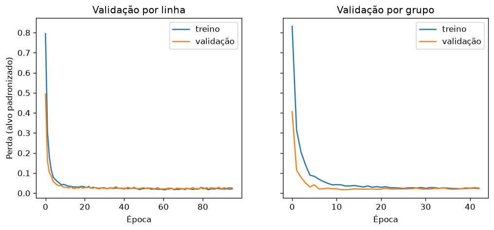

# Conclusões dos experimentos de otimização

Experimentos do plano [2026-11-05-investigacao-otimizacao.md](../../docs/superpowers/plans/2026-11-05-investigacao-otimizacao.md), rodados de 06/11 08:24 a 07/11 06:36 em `fuel_treino`. Os resultados brutos estão nos `.json` desta pasta.

**Resumo:** nenhuma hipótese passou com folga no critério de 2 desvios-padrão.
- O XGBoost publicado (5,77 %) continua sendo o modelo e não muda.
- A busca já estava convergida, e os erros que ficaram parados vêm sobretudo do limite dos dados e do ruído das sementes.
- O próximo teste que faz sentido é outro algoritmo de boosting, começando pelo CatBoost.

Todos os erros são o erro percentual médio em MJ/km, na CV externa com 5 dobras por grupo.

## Ruído (a régua de cada comparação)

| Origem do ruído | Como foi medido | Desvio | 2 desvios |
|---|---|---|---|
| Semente do modelo, XGBoost (H3) | parâmetros publicados fixos, 5 sementes | 0,11 ponto | **0,22 ponto** |
| Semente da busca, XGBoost | TPE com 3 sementes do sampler, 50 tentativas | 0,035 ponto | **0,07 ponto** |
| Semente do modelo, rede por alvo | parâmetros da rodada 3 fixos, 5 sementes, validação por linha | 0,25 ponto | **0,49 ponto** |

O desvio da busca saiu de só 3 sementes, então é uma estimativa frágil.

## H3: parte das diferenças é ruído de semente

Os parâmetros publicados ficam fixos e só a semente do XGBoost muda.

| Semente | MJ/km | Combustão | Elétrico | Híbrido | Plug-in |
|---|---|---|---|---|---|
| 0 | 5,62 | 4,60 | 4,79 | 7,06 | 11,54 |
| 1 | 5,72 | 4,73 | 4,70 | 7,51 | 11,33 |
| 2 | 5,66 | 4,51 | 4,83 | 7,35 | 11,96 |
| 3 | 5,50 | 4,40 | 4,77 | 7,39 | 11,01 |
| 4 | 5,80 | 4,66 | 4,79 | 7,62 | 12,25 |
| **média** | **5,66 ± 0,11** | | | | |

**Veredito: confirmada.** Só a semente move o erro em 0,3 ponto (de 5,50 a 5,80 %). Diferenças menores que ~0,2 ponto entre configurações do XGBoost não querem dizer nada.

A média, 5,66 %, sai abaixo dos 5,77 % oficiais. A diferença acontece porque estes parâmetros foram escolhidos olhando a base inteira; o número oficial escolhe sem ver a dobra de teste.

## H1: outro buscador acharia algo melhor que o TPE

Mesma CV aninhada do XGBoost, com 50 tentativas por estudo.

| Buscador | MJ/km | Combustão | Elétrico | Híbrido | Plug-in |
|---|---|---|---|---|---|
| TPE (semente 0) | 5,77 | 4,66 | 4,91 | 7,60 | 11,77 |
| TPE (semente 1) | 5,72 | 4,54 | 4,62 | 7,49 | 12,72 |
| TPE (semente 2) | 5,71 | 4,70 | 4,49 | 7,57 | 11,81 |
| **TPE, média** | **5,73 ± 0,035** | | | | |
| QMC | 5,72 | 4,61 | 4,59 | 7,76 | 12,01 |
| GP | 5,74 | 4,62 | 4,50 | 7,89 | 12,23 |
| Aleatório | 5,84 | 4,81 | 4,38 | 8,31 | 11,89 |
| CMA-ES | 5,88 | 4,82 | 5,09 | 7,46 | 11,70 |

**Veredito: rejeitada.** Os outros buscadores ficam assim em relação à média do TPE:
- **QMC e GP** empatam, com diferenças de −0,01 e +0,01 ponto;
- **Aleatório e CMA-ES** são piores, com +0,11 e +0,15 ponto.

O TPE continua como buscador padrão, e o Simulated Annealing próprio não se justifica.

**Ressalva:** o H1 foi testado só no XGBoost, cuja busca já convergia cedo (entre a tentativa 19 e a 51). O resultado não diz nada sobre as redes, que ainda melhoravam no fim da busca.

## H2: a faixa de busca (a "cerca") do XGBoost é estreita

CV aninhada com `xgboost_amplo`, 100 tentativas por estudo, comparada com o XGBoost oficial, que usou as mesmas 100 tentativas.

| Modelo | MJ/km | Combustão | Elétrico | Híbrido | Plug-in |
|---|---|---|---|---|---|
| XGBoost oficial (faixa atual) | 5,77 | 4,63 | 4,92 | 7,61 | 11,84 |
| XGBoost faixa ampla | 5,69 | 4,65 | 4,69 | 7,00 | 12,20 |

**Veredito: não confirmada, ganho no limite do ruído.** A faixa ampla melhora 0,08 ponto.
- Pelo critério da busca (0,07 ponto), passa por 0,01 ponto. Mas esse desvio vem de só 3 sementes.
- Não passa no critério da semente do modelo (0,22 ponto).
- A melhor semente do TPE com a faixa atual já chega a 5,71 %, só 0,02 ponto acima.

O Híbrido melhora 0,6 ponto, mas cada propulsão tem poucos carros, então o ruído ali é maior.

**Bordas da faixa ampla** (o parâmetro escolhido encostou no limite):

| Dobra | Árvores | Profundidade | Parâmetro na borda |
|---|---|---|---|
| 1 | 908 | 6 | `reg_lambda` = 0,0013 (mínimo 0,001) |
| 2 | 2520 | 3 | `min_child_weight` = 0 (mínimo) |
| 3 | 2639 | 7 | nenhum |
| 4 | 1595 | 7 | nenhum |
| 5 | 2015 | 8 | nenhum |

A busca usou a folga nova: profundidade até 8 e até 2.639 árvores, contra o limite antigo de 6 e 1.500. Mesmo assim, o erro quase não mudou. As dobras escolheram combinações bem diferentes e chegaram a erros parecidos. Isso indica um platô: o XGBoost já está perto do que estes dados permitem.

O custo é que as árvores da faixa ampla são maiores, e as tentativas ficaram 2 a 3 vezes mais lentas.

## H4: as redes param na hora errada por causa dos "irmãos" na validação

Rede por alvo com os parâmetros da rodada 3. A validação da parada antecipada é feita de dois jeitos: por linha, como é hoje, ou por grupo, sem irmãos.

| Semente | Por linha | Por grupo |
|---|---|---|
| 0 | 6,72 | 6,80 |
| 1 | 6,71 | 6,57 |
| 2 | 7,18 | 6,61 |
| 3 | 6,87 | 6,75 |
| 4 | 6,51 | 6,51 |
| **média** | **6,80 ± 0,25** | **6,65 ± 0,12** |

Por propulsão, na média das 5 sementes:

| Validação | Combustão | Elétrico | Híbrido | Plug-in |
|---|---|---|---|---|
| Por linha | 5,48 | 5,66 | 7,71 | 15,73 |
| Por grupo | 5,32 | 5,61 | 7,77 | 15,17 |

**Veredito: não confirmada.** A validação por grupo melhora 0,15 ponto, abaixo dos 0,49 do critério. Ela também deixa a rede mais estável: o desvio cai pela metade (0,12 contra 0,25), mas com só 5 sementes isso também é frágil.

**Ressalva:** os parâmetros foram ajustados com a validação por linha. Um empate aqui não descarta a validação por grupo: com uma busca feita já com ela, o resultado pode ser outro.

**Curvas de perda** (dobra externa 1, alvo `mj_km_urbano`, semente 0):

Nos dois modos, a validação acompanha o treino de perto, sem sinal de sobreajuste. Com validação por grupo, a parada vem mais cedo, por volta da época 42 contra a 95.

## H5: a média de várias redes ajuda

| Configuração | MJ/km | Combustão | Elétrico | Híbrido | Plug-in |
|---|---|---|---|---|---|
| 1 rede (média de 5 sementes, validação por linha) | 6,80 ± 0,25 | 5,48 | 5,66 | 7,71 | 15,73 |
| média de 5 redes | 6,55 | 5,31 | 5,34 | 7,32 | 15,36 |

**Veredito: não confirmada.** A média de 5 redes melhora 0,25 ponto, abaixo dos 0,49 do critério. A tendência vai na direção esperada, mas custa 5 vezes o tempo de treino.

## H6: a taxa de aprendizado atrapalha

Grade fixa de `lr` com a semente 0. O `lr` da rodada 3 é 0,00052, e com ele a rede ficou em 6,72 %.

| `lr` | MJ/km | Combustão | Elétrico | Híbrido | Plug-in |
|---|---|---|---|---|---|
| 0,0001 | 7,13 | 5,60 | 6,26 | 8,75 | 15,75 |
| 0,0003 | 6,80 | 5,36 | 5,68 | 8,01 | 16,06 |
| 0,001 | 6,68 | 5,35 | 5,83 | 7,38 | 15,32 |
| 0,003 | 6,82 | 5,67 | 5,72 | 8,13 | 14,24 |
| 0,01 | 8,04 | 6,01 | 6,72 | 8,97 | 21,39 |

**Veredito: rejeitada.** Entre 0,0003 e 0,003 o erro fica num platô (6,68 a 6,82 %), e o `lr` escolhido está no meio dele. Só os extremos pioram, sobretudo 0,01 (+1,3 ponto).

## O que fica para depois

Cada item seria um plano e um PR próprios. Nada muda no modelo publicado por causa destes experimentos.

1. **Testar o CatBoost, e depois o LightGBM.** A condição do plano se cumpriu, porque a faixa ampla melhorou pouco. É a melhor chance de ganho, já que o XGBoost parece ter chegado ao limite com este algoritmo.
2. **Opcional: repetir a faixa ampla com 3 sementes de busca** (~8 h), para fechar o H2. Só vale se o CatBoost não vencer: os 0,08 ponto de agora não pagam as árvores maiores e o treino mais lento.
3. **Redes, baixa prioridade:** juntar a validação por grupo e a média de 5 redes numa nova busca (`VERSAO = 3`). As duas tendências são boas, mas a rede está cerca de 1 ponto atrás do XGBoost, e nem somando os dois ganhos ela chegaria lá.
4. **Sem mudança:** o TPE continua como buscador, e a faixa de `lr` das redes continua a mesma.

## Execução

- **Ordem:** os 4 experimentos rodaram em sequência, via WMI.
- **Estrangulamento:** entre 12h e 16h de 06/11, o carregador mal encaixado fez o processador rodar a 33 % da velocidade. Isso só atrasou o `cerca` e não afeta os resultados.
- **Tempo de cada experimento:**
  - `sementes`: 4 min;
  - `redes`: 3h40;
  - `cerca`: 9h20;
  - `samplers`: 9h10.
