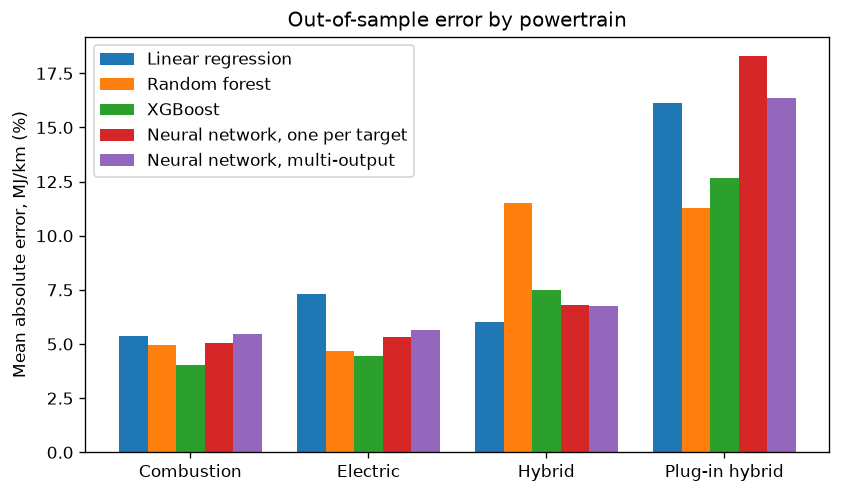
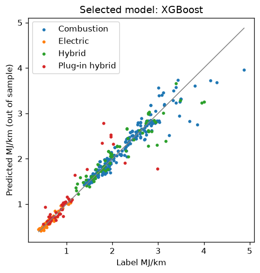

# Training report: vehicle energy efficiency

Date: 2026-11-26 · data hash: `7f9a2a41`

**Selected model: XGBoost**, the lowest error among the candidates that pass the monotonicity check.

Hyperparameters: `{'n_estimators': 635, 'max_depth': 6, 'learning_rate': 0.02539564354657952, 'subsample': 0.9633871589432483, 'colsample_bytree': 0.5959057813515273, 'min_child_weight': 3, 'reg_lambda': 0.0013970069248023164}`

Errors are the mean absolute percentage error on combined MJ/km, out of sample (nested cross-validation grouped by model family).

## Candidates

| Candidate | MJ/km error | Monotonicity | Trials |
|---|---|---|---|
| Linear regression | 6.92 % | pass | 600 |
| Random forest | 6.36 % | pass | 600 |
| XGBoost | 5.4 % | pass | 600 |
| Neural network, one per target | 6.62 % | pass | 600 |
| Neural network, multi-output | 6.75 % | pass | 600 |

## Error by powertrain (MJ/km)

| Candidate | Combustion | Electric | Hybrid | Plug-in hybrid |
|---|---|---|---|---|
| Linear regression | 5.36 % | 7.33 % | 6.01 % | 16.12 % |
| Random forest | 4.97 % | 4.68 % | 11.51 % | 11.3 % |
| XGBoost | 4.04 % | 4.43 % | 7.49 % | 12.65 % |
| Neural network, one per target | 5.03 % | 5.32 % | 6.8 % | 18.29 % |
| Neural network, multi-output | 5.48 % | 5.66 % | 6.77 % | 16.34 % |

## Figures

