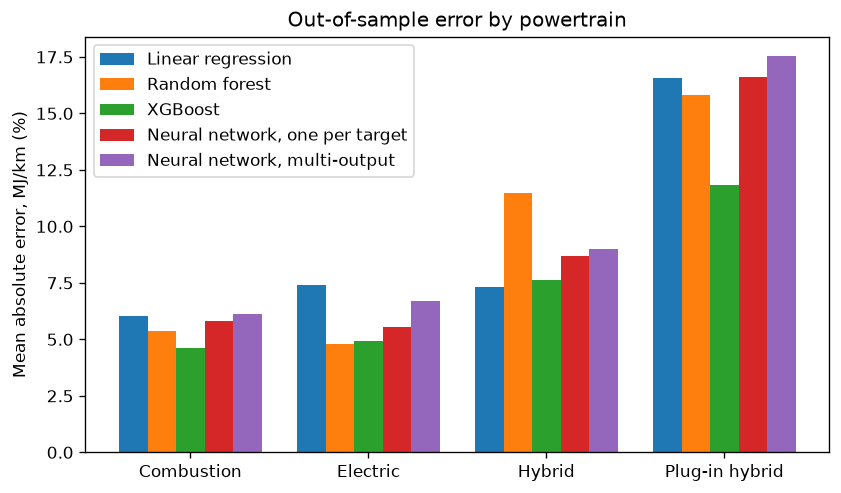
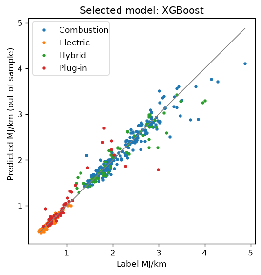

# Training report: vehicle energy efficiency

Date: 2026-11-05 · data hash: `dd888117`

**Selected model: XGBoost**, the lowest error among the candidates that pass the monotonicity check.

Hyperparameters: `{'n_estimators': 969, 'max_depth': 5, 'learning_rate': 0.032637691707401356, 'subsample': 0.6437132638022895, 'colsample_bytree': 0.5795595752000016, 'min_child_weight': 5, 'reg_lambda': 0.002883631811041725}`

Errors are the mean absolute percentage error on combined MJ/km, out of sample (nested cross-validation grouped by model family).

## Candidates

| Candidate | MJ/km error | Monotonicity | Trials |
|---|---|---|---|
| Linear regression | 7.52 % | pass | 900 |
| Random forest | 7.02 % | pass | 674 |
| XGBoost | 5.77 % | pass | 600 |
| Neural network, one per target | 7.16 % | pass | 301 |
| Neural network, multi-output | 7.72 % | pass | 300 |

## Error by powertrain (MJ/km)

| Candidate | Combustion | Electric | Hybrid | Plug-in hybrid |
|---|---|---|---|---|
| Linear regression | 6.04 % | 7.39 % | 7.31 % | 16.57 % |
| Random forest | 5.36 % | 4.8 % | 11.47 % | 15.83 % |
| XGBoost | 4.63 % | 4.92 % | 7.61 % | 11.84 % |
| Neural network, one per target | 5.81 % | 5.55 % | 8.68 % | 16.59 % |
| Neural network, multi-output | 6.12 % | 6.71 % | 9 % | 17.53 % |

## Figures

